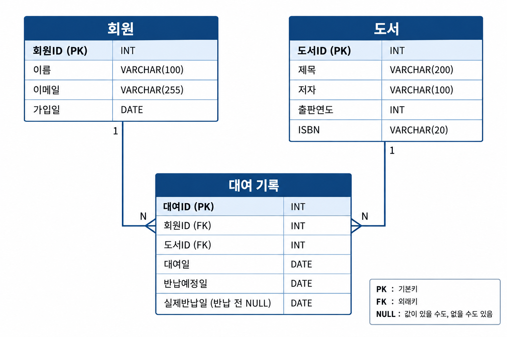
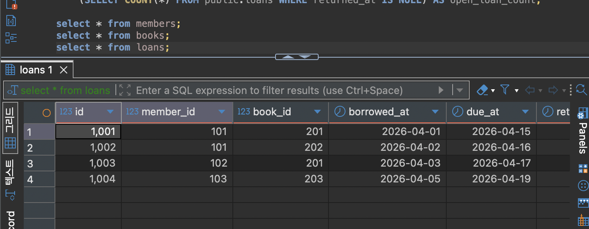

# Chapter 05 확장 실습 답안 템플릿

> **과제:** 요구사항에서 데이터 모델과 ERD 만들기  
> **사용 방법:** 이 파일을 내려받아 본인의 GitHub 저장소에 `chapter05_answer.md`라는 이름으로 저장한 뒤 실습하면서 바로 작성합니다.  
> **제출 방법:** LMS에는 파일을 직접 업로드하지 않고, **본인 GitHub 저장소의 `chapter05_answer.md` 파일 URL**을 제출합니다.

---

## 제출 전 주의

이 파일과 캡처 화면에는 실제 비밀번호, 전체 DB 접속 URL, API Key, 개인정보를 기록하지 않습니다.

```text
GitHub 계정 또는 별칭: seohee0233
과제 작성일: 2026-10-12
사용한 AI 도구: chat GPT
```

---

# 1. Chapter 05 핵심 개념 복습

본문을 보지 않고 먼저 작성합니다.

```text
요구사항에서 바로 테이블부터 만들면 위험한 이유: 필요한 내용을 없애거나 구조가 바뀔 수 있음

한 행의 의미를 먼저 정해야 하는 이유: 한 행이 무엇을 의미하는지 헷갈리지 않음

확정 요구사항과 미확정 정책을 구분해야 하는 이유: 아직 정해지지 않은 규칙을 마음대로 정하면 안되니까

PK와 업무상 고유값 후보의 차이: PK는 한 행을 구분하는 번호이고, 고유값은 학번이나 이메일처럼 고유한 값이다.

N:M 관계를 그대로 두지 않고 연결 테이블을 검토하는 이유: 연결 테이블을 통해 관계까지 관리 가능하니까

```

---

# 2. 도서 대여 요구사항 R-01~R-07 다시 분해

| 요구사항 | 관리 대상 / 사건 | 속성 후보 | 관계 / 규칙 후보 | 미확정 질문 |
| --- | --- | --- | --- | --- |
| R-01 | 도서관 회원 | 이름, | 도서관이 회원을 관리함 | - |
| R-02 | 회원 | 이름, 이메일, 가입일 | 이름은 필수이다 | 이메일은 중복될 수 있나 |
| R-03 | 도서 | 제목, 저자, 출판연도, ISBN |  | 출판연도는 꼭 입력해야 하나 |
| R-04 | 대여 | - | 회원은 여러 권을 대여할 수 있음 | 한 번에 몇 권까지 대여할 수 있나 |
| R-05 | 대여 | - | 같은 책도 여러 번 대여될 수 있음 | 같은 책이 여러권일 수는 없나 |
| R-06 | 대여 기록 | 대여일, 반납예정일, 실제반납일 | 대여 기록에 날짜를 저장함 | 반납예정일은 자동으로 들어가나 |
| R-07 | 대여 기록 | 실제반납일 | 반납 전에는 실제반납일이 비어 있을 수 있음 | 실제반납일이 연휴이면 어떻게 하나 |


### 본문과 비교한 뒤 수정한 내용

```text
처음에 놓친 부분: 책은 시간에 따라서 여러 번 대여될 수 있음

처음에 잘못 분류한 부분: 책을 한번만 대여하도록 함

수정한 이유: 시간이 지나고 반납되면 대여 가능
```

---

# 3. 확정 규칙과 미확정 정책 구분

## 3-1. 확정된 규칙

```text
1. 회원과 도서를 관리하는 것
2. 대여일과 반납 예정일
3. 대여 기록으로 회원-도서 연결
4. 실제 반납일은 반납 전까지 비어있을 수 있음
5. 대여일은 비어있으면 안됨

```

## 3-2. 미확정 질문

최소 5개를 작성합니다.

```text
Q1. 대소문자 구분하나?
Q2. 이메일을 필수로 하나?
Q3. 한 명 당 가장 많이 대여할 수 있는 횟수는?
Q4. 연체시 어떤 패널티가 있나?
Q5. 이메일이 없는 경우에는?

```

### 미확정 정책을 바로 `UNIQUE`, `CHECK`, 삭제 규칙으로 구현하면 위험한 이유

```text
정책이 정해지기 전에 규칙을 만들면 필요한 데이터를 입력하지 못하거나 삭제할 수 있으므로, 먼저 정책을 확인함.
```

---

# 4. 엔터티·속성·사건 후보 구분

| 후보 | 대상 엔터티 / 사건 엔터티 / 속성 | 판단 근거 | 독립 식별 필요? |
| --- | --- | --- | --- |
| 회원 | 대상 | 여러 속성을 가지고 대여 기록과 연결됨 | 필요 |
| 도서 | 대상 | 제목, 저자 등의 정보를 가짐 | 필요 |
| 대여 기록 | 사건 | 회원이 도서를 대여한 사건을 반복해서 기록함 | 필요 |
| 이메일 | 속성 | 회원의 정보를 나타냄 | 필요하지 않음 |
| ISBN | 속성 | 도서의 정보를 나타냄 | 필요 |
| 반납예정일 | 속성 | 대여 기록에 저장하는 날짜 | 필요 |

### “명사가 보이면 무조건 테이블”이 아닌 이유

```text
명사라도 다른 대상을 설명하는 값이면 속성일 수 있으므로
```

---

# 5. 테이블별 한 행의 의미와 키 후보

| 테이블 | 한 행의 의미 | PK 후보 | 업무상 고유값 후보 | FK 후보 |
| --- | --- | --- | --- | --- |
| `members` | 회원 한 명 | `member_id` | 이메일 | 없음 |
| `books` | 도서 한 권 | `book_id` | ISBN | 없음 |
| `loans` | 도서 대여 한 건 | `loan_id` | 없음 | `member_id`, `book_id` |

### `members.email`을 지금 바로 UNIQUE라고 확정하지 않는 이유

```text
이메일이 회원마다 꼭 달라야 하는지 아직 정해지지 않았기 때문임.
```

### `books.isbn`을 지금 바로 NOT NULL + UNIQUE라고 확정하지 않는 이유

```text
ISBN이 없는 도서도 등록할 수 있는지, 같은 ISBN을 가진 책을 여러 권 등록하는지 아직 정해지지 않았기 때문임.
```

---

# 6. 관계를 양방향 문장으로 작성

## 6-1. `members ↔ loans`

```text
회원 한 명은 여러 대여 기록을 가질 수 있다.

대여 기록 한 건은 한 회원만 가진다.

카디널리티: members 1 ── N loans
선택성에서 확인할 점: 멤버 하나가 여러개의 대여를 가지나.
```

## 6-2. `books ↔ loans`

```text
도서 한 건은 시간에 따라 여러 대여 기록을 가질 수 있다.

대여 기록 한 건은 정확히 한 도서를 참조한다.

카디널리티: books 1 ── N loans
선택성에서 확인할 점: 책이 여러번 대여되는 것은?
```

## 6-3. `members ↔ books`를 직접 N:M으로 저장하지 않고 `loans`를 두는 이유

```text
대여일, 반납예정일, 실제반납일 같은 관계 자체의 속성을 저장할 수 있기에
```

### `loans`가 단순 연결표가 아니라 사건 엔터티라고 볼 수 있는 이유

```text
대여일, 반납예정일, 실제반납일처럼 회원과 도서의 관계에 대한 정보를 저장하기 때문임.
```

---

# 7. 도서 대여 ERD 초안

아래 항목이 보이도록 ERD를 작성합니다.

```text
members
books
loans
PK
FK
주요 속성
1:N 관계
```

권장 이미지 경로:

```text
assignments/chapter05/images/step07_library_erd.png
```

Markdown 예시:

```markdown

```

![도서 대여 ERD] (./images/step07_library_erd.png)

### ERD를 그린 뒤 수정한 부분

```text
실제 반납 전에는 returned_date가 비어 있을 수 있다는 점 추가
```

---

# 8. PostgreSQL로 도서 대여 모델 구현 확인

## 8-1. 현재 환경 확인

```sql
SELECT current_database();
SELECT current_user;
SELECT current_schema();
SHOW search_path;
SHOW transaction_read_only;
```

```text
현재 DB: ai_database_book
현재 사용자: postgres
현재 스키마: public
search_path: public, "$user"
읽기 전용 여부: off
```

- [v] 현재 DB가 `ai_database_book`이다.
- [v] 실행 범위를 확인했다.
- [v] Auto-commit 상태를 확인했다.

## 8-2. 스키마 생성 SQL 실행

사용 파일:

```text
code/chapter05/01_library_schema.sql
```

실행 전 예상:

```text
생성될 테이블 수: 3
생성 순서: members > book > loans
각 테이블 예상 행 수: 0개씩
```

실행 후 실제:

```text
members 존재: 없음
books 존재: 없음
loans 존재: 없음
각 테이블 행 수: 0개
```

### `loans`를 마지막에 만드는 이유

```text
members와 books의 관계를 포함하고 있기 때문에 가장 마지막에 생성함
```

---

# 9. 샘플 데이터 입력과 관계 관찰

사용 파일:

```text
code/chapter05/02_library_seed.sql
```

## 9-1. 실행 전 예상

```text
members 예상 행 수: 3
books 예상 행 수: 3
loans 예상 행 수: 4
미반납 예상 건수: 3 
회원 101 대여 예상 건수: 2
도서 201 대여 예상 건수: 2
```

## 9-2. 실제 결과

```text
members 실제 행 수: 3
books 실제 행 수: 3
loans 실제 행 수:
미반납 실제 건수:
회원 101 대여 실제 건수: 2
도서 201 대여 실제 건수: 2
```

### 샘플 데이터에서 확인한 1:N 관계

```text
같은 회원 ID가 여러개의 loan 가짐
```

### `returned_at = NULL`이 의미하는 것

```text
아직 반납되지 않음
```

### 증거 화면

권장 경로:

```text
assignments/chapter05/images/step09_seed_result.png
```



---

# 10. 검증 SQL 실행

사용 파일:

```text
code/chapter05/03_library_validation.sql
```

## 10-1. 결과 기록

```text
members = 3
books = 3
loans = 4
미반납 건수 = 3
회원 101 대여 이력 = 2
도서 201 대여 이력 = 2
회원 참조 고아 행 = 0
도서 참조 고아 행 = 0
loans FK 개수 = 2
검증 최종 메시지 = Chapter 05 library model validation passed
```

### 단순히 테이블 3개가 생성되었다고 설계 검증이 끝난 것이 아닌 이유

```text
FK가 연결된건지, 관계가 정상인지, 고아 참조는 없는지, 미반납 상태가 표현되었는지 모른다.
```

### 증거 화면

권장 경로:

```text
assignments/chapter05/images/step10_validation.png
```


---

# 11. 작은 시나리오로 모델 검증

아래 시나리오를 현재 모델이 표현할 수 있는지 판단합니다.

| 시나리오 | 표현 가능? | 이유 | 추가 확인할 정책 |
| --- | --- | --- | --- |
| 회원 A가 서로 다른 책 2권을 대여 | 가능 | 대여 기록을 두 건 만들면 됨 | 한 번에 빌릴 수 있는 권수 |
| 같은 책을 시간 차를 두고 다시 대여 | 가능 | 대여 기록을 여러 건 저장할 수 있음 | 없음 |
| 아직 반납하지 않은 대여 | 가능 | 실제 반납일을 비워 두면 됨 | 없음 |
| 회원은 있지만 대여 기록이 없음 | 가능 | 회원 정보와 대여 기록은 별도로 저장됨 | 없음 |
| ISBN이 없는 도서 | 가능 | ISBN을 비워 둘 수 있음 | ISBN 입력을 필수로 할지 |
| 같은 ISBN의 실물 복본 2권 | 확인 필요 | 현재 도서 한 행이 실물 한 권인지 제목 단위인지 불분명함 | 책 한 권을 복본별로 관리할지 |
| 한 도서에 저자 2명 | 확인 필요 | 현재 저자 속성 하나로는 여러 저자를 표현하기 어려울 수 있음 | 여러 저자를 저장할지 |
| 같은 도서를 두 명이 동시에 대여 | 정책 확인 필요 | 대여 기록은 여러 건 만들 수 있지만 동시 대여를 막는 규칙은 정해지지 않음 | 실물 복본 단위로 대여를 제한할지 |

### 현재 Chapter 05 모델의 한계 3가지

```text
1. 미래 요구사항을 미리 넣어서 수정 어려움
2. 현재 요구사항과 범위를 정확하게 표현함
3. 한계를 너무 명확하게 기록함.
```

---

# 12. Chapter 01~04 개인 서비스 요구사항 작성

지금까지 선택한 개인 서비스 아이디어를 사용합니다.

```text
서비스 이름: 경영대 대여 서비스 관리 시스템
서비스 목적: 경영대에서 진행 중인 대여 서비스를 보다 효율적이고 효과적으로 관리
```

## 12-1. 요구사항

최소 8개를 작성합니다.

```text
P05-R01. 서비스는 학생 한 명의 학번, 이름, 전공 정보를 저장해야 한다.
P05-R02. 서비스는 실제 대여 물품 한 개씩의 종류, 물품 번호, 현재 상태를 저장해야 한다.
P05-R03. 서비스는 학생 한 명이 물품 한 개를 대여한 사건을 저장해야 한다.
P05-R04. 서비스는 각 대여 사건의 대여 일시, 반납 예정 일시, 실제 반납 일시를 저장해야 한다.
P05-R05. 같은 실제 물품은 같은 시간에 한 학생에게만 대여될 수 있어야 한다.
P05-R06. 한 학생은 서로 다른 품목을 동시에 빌릴 수 있지만, 같은 품목은 동시에 두 개 이상 빌릴 수 없어야 한다.
P05-R07. 서비스는 연체한 학생에게 적용된 대여 제한의 사유, 시작일, 종료일을 저장해야 한다.
P05-R08. 종료되지 않은 대여 제한이 있는 학생은 모든 품목을 대여할 수 없어야 한다.
P05-R09. 서비스는 대여·반납을 처리하는 관리자와 관리자의 담당 요일 및 시간을 저장해야 한다.
```

> 화면 기능보다 **저장해야 할 사실, 반복 사건, 상태와 관계**를 중심으로 작성합니다.

## 12-2. 미확정 질문

최소 3개를 작성합니다.

```text
P05-Q01. 대여 가능 기간은 모든 품목에 동일하게 적용되는가, 아니면 품목별로 다른가?
P05-Q02. 연체에 따른 7일 제한은 실제 반납한 날부터 계산하는가, 반납 예정일이 지난 날부터 계산하는가?
```

---

# 13. 개인 서비스 모델 초안

## 13-1. 엔터티·사건 후보표

| 후보 | 대상 / 사건 | 한 행의 의미 | 주요 속성 | PK 후보 | 업무 식별자 후보 |
| --- | --- | --- | --- | --- | --- |
| `students` | 대상 | 서비스에 등록된 학생 한 명 | student_number, student_name, major | student_id | student_number |
| `items` | 대상 | 실제 대여 가능한 물품 한 개 | item_type, item_number, item_status | item_id | item_number |
| `rentals` | 사건 | 학생 한 명이 물품 한 개를 대여한 한 건의 기록 | student_id, item_id, rented_at, due_at, returned_at, admin_id | rental_id | 아직 확정하지 않음 |
| `penalties` | 사건 | 연체 등으로 학생에게 적용된 대여 제한 한 건 | student_id, reason, restriction_start_date, restriction_end_date | penalty_id | 아직 확정하지 않음 |
| `admins` | 대상 | 대여·반납을 처리하는 관리자 한 명 | admin_name, duty_day, duty_start_time, duty_end_time | admin_id | 아직 확정하지 않음 |

## 13-2. 관계 문장

```text
관계 1: students와 rentals
학생 한 명은 시간차를 두고 여러 건의 대여 기록을 가질 수 있다.
대여 기록 한 건은 반드시 한 학생을 참조한다.

관계 2: items와 rentals
물품 한 개는 반납된 뒤 여러 번 대여될 수 있다.
대여 기록 한 건은 반드시 한 개의 실제 물품을 참조한다.

관계 3: students와 penalties
학생 한 명은 여러 건의 대여 제한 기록을 가질 수 있다.
대여 제한 기록 한 건은 반드시 한 학생에게 적용된다.

관계 4: admins와 rentals
관리자 한 명은 여러 건의 대여·반납 처리를 담당할 수 있다.
대여 기록 한 건은 한 명의 담당 관리자를 참조한다.
```

## 13-3. N:M 관계 검토

```text
N:M 관계 후보: students와 items

연결 테이블 후보: rentals

연결 테이블 한 행의 의미:
학생 한 명이 실제 물품 한 개를 대여한 한 건의 기록

연결 테이블 자체에 필요한 사건 속성:
대여 일시, 반납 예정 일시, 실제 반납 일시, 담당 관리자
```

---

# 14. 개인 서비스 ERD 초안

ERD에 최소 다음을 표시합니다.

```text
테이블 3개 이상
각 테이블 PK
주요 속성
필요한 FK
관계선
카디널리티
```

권장 이미지 경로: 

```text
assignments/chapter05/images/step14_my_erd.png
```


### ERD의 각 테이블이 어떤 요구사항에서 나왔는지 설명

| 테이블 | 근거 요구사항 ID | 한 행의 의미 |
| --- | --- | --- |
| students | P05-R01 | 학생 한 명의 기본 정보이다. |
| items | P05-R02, P05-R05 | 대여할 수 있는 실제 물품 한 개의 정보이다. 예: 계산기 1번, 우산 3번 |
| 품목별 대여 테이블 6개 | P05-R03, P05-R04, P05-R05, P05-R06 | 학생 한 명이 물품 한 개를 대여한 한 번의 기록이다. |
| admins | P05-R03 | 대여 또는 반납을 처리한 관리자 한 명의 정보이다. |
| penalties | P05-R07, P05-R08 | 학생 한 명에게 발생한 연체 제한 한 건의 기록이다. |

---

# 15. 요구사항 추적표

| 요구사항 ID | 데이터 모델 반영 위치 | 검증 방법 | 상태 |
| --- | --- | --- | --- |
| P05-R01 | `students` 테이블의 학번, 이름, 학과, 연락처 | 학생 정보를 한 건 입력하고 조회한다. | 반영 |
| P05-R02 | `items` 테이블의 품목 종류, 물품 번호, 상태 | 계산기 1번, 우산 1번처럼 실제 물품을 각각 저장한다. | 반영 |
| P05-R03 | 품목별 대여 테이블의 `student_id`, `item_id`, `admin_id` FK | 학생·물품·관리자 정보를 연결하여 대여 기록을 입력한다. | 반영 |
| P05-R04 | 품목별 대여 테이블의 `rented_at`, `due_at`, `returned_at` | 대여일, 반납 예정일, 실제 반납일이 저장되는지 확인한다. | 반영 |
| P05-R05 | 품목별 대여 테이블의 `item_id`, `returned_at` | 아직 반납되지 않은 같은 물품을 다른 학생이 빌리려고 할 때 막히는지 확인한다. | 확인필요 |
| P05-R06 | 품목별 대여 테이블의 `student_id`, `returned_at` | 한 학생이 우산과 계산기는 함께 빌리되, 같은 품목을 두 개 빌리지 못하는지 확인한다. | 확인필요 |
| P05-R07 | `penalties` 테이블의 사유, 시작일, 종료일 | 연체 학생에게 7일 제한 기록을 저장하고 조회한다. | 반영 |
| P05-R08 | `penalties.student_id`, `start_date`, `end_date` | 제한 기간 안인 학생이 어떤 품목이든 대여할 수 없는지 확인한다. | 확인필요 |

### ERD 그림만으로 요구사항 누락을 발견하기 어려운 이유

```text
ERD는 테이블과 관계를 보여 주지만, "같은 품목은 동시에 2개 이상 대여할 수 없다"는 세부 업무 규칙을 못 보여준다.
```

---

# 16. 개인 서비스 작은 데이터 시나리오 검증

가상 데이터만 사용합니다.

```text
사용자/대상 A: 학생 박서희, 
사용자/대상 B: 학생 김민지, student_id = 2

대상 X: 우산 U-01, item_id = 1
대상 Y: 계산기 C-01, item_id = 2

사건 1:
박서희가 10월 1일에 우산 U-01을 대여한다.
반납 예정일은 10월 2일이다.

사건 2:
박서희가 10월 1일에 계산기 C-01을 대여한다.
서로 다른 품목이므로 우산과 계산기를 동시에 빌릴 수 있다.

사건 3:
박서희가 10월 4일에 우산 U-01을 반납한다.
반납 예정일보다 늦었으므로 10월 4일부터 10월 10일까지의 패널티 기록을 생성한다.

사건 4:
김민지가 10월 4일에 반납된 우산 U-01을 대여한다.
우산 U-01은 이미 반납되었으므로 다시 대여할 수 있다.
```

### 이 시나리오를 현재 ERD로 저장할 수 있는가?

```text
저장 가능. 
```

### 저장하기 어려운 상황 또는 모호한 부분

```text
박서희가 패널티 기간 중 보조배터리 대여를 요청했다가 거절된 사실은 현재 ERD에 저장할 테이블이 없다.
```

### 시나리오 검증 후 수정한 ERD 내용

```text
없음 
```

---

# 17. AI를 설계자가 아니라 리뷰어로 활용

## 17-1. AI에게 전달한 핵심 자료

```text
요구사항: 나의 서비스 구축에 있어서 미확정 질문과 관련된 피드백을 5개 이상 진행해줘

미확정 질문: P05-Q02. 연체에 따른 7일 제한은 실제 반납한 날부터 계산하는가, 반납 예정일이 지난 날부터 계산하는가?

테이블별 한 행 의미:
- students: 서비스에 등록된 학생 한 명
- items: 실제 대여 가능한 물품 한 개
- rentals: 학생 한 명이 물품 한 개를 대여한 한 건
- penalties: 학생 한 명에게 적용된 대여 제한 한 건
- admins: 대여·반납 업무를 담당하는 관리자 한 명

관계 문장:
- 학생 한 명은 여러 건의 대여 기록을 가질 수 있고, 대여 기록 한 건은 한 학생을 참조한다.
- 물품 한 개는 여러 번 대여될 수 있고, 대여 기록 한 건은 한 물품을 참조한다.
- 학생 한 명은 여러 건의 패널티 기록을 가질 수 있고, 패널티 한 건은 한 학생에게 적용된다.

ERD 설명:
students와 items는 rentals를 통해 연결된다.
rentals에는 대여·반납과 관련된 날짜 속성을 저장한다.
penalties에는 제한 기간을 저장한다.
```

## 17-2. AI 검토 요청

실제로 사용한 프롬프트 또는 핵심 내용을 기록합니다.

```text
나의 서비스 구축에 있어서 미확정 질문과 관련된 피드백을 5개 이상 진행해줘. 

```

## 17-3. AI 제안 검토

| AI 제안 또는 질문 | 수용 / 수정 / 보류 / 거절 | 실제 근거 요구사항 | 나의 판단 이유 |
| --- | --- | --- | --- |
| 품목별 대여 기간을 다르게 설정할 수 있음 | 보류 | P05-R04 | 대여일과 반납 예정일은 필요하지만, 품목별 정확한 기간은 아직 정하지 않았다. |
| 연체 제한은 반납 예정일 다음 날부터 적용할 수 있음 | 보류 | P05-R07, P05-R08 | 연체 시 7일 대여 제한은 정했지만, 정확한 시작 날짜는 더 확인이 필요하다. |
| 대여 테이블을 `rentals` 하나로 통합 | 거절 | P05-R03, P05-R06 | 이번 프로젝트는 품목별 대여 테이블을 나누어 구성하기로 결정하였다. |
| 패널티 기간이 끝나도 기록은 삭제하지 않음 | 수용 | P05-R07, P05-R08 | 대여 제한은 끝나더라도 과거 연체 기록은 확인할 수 있어야 한다. |

### AI가 요구사항에 없는 정책을 임의로 확정한 부분이 있었나요?

```text
AI는 대여 테이블을 하나로 통합하는 방법을 제안하였다.
```

### AI 검토를 받고도 채택하지 않은 제안 하나와 그 이유

```text
대여 테이블을 rentals 테이블 하나로 통합하자는 제안을 채택하지 않았다.

통합 테이블도 일반적으로 사용할 수 있는 설계이지만, 이번 프로젝트에서는 우산, 계산기, 노트북 충전기 등 품목별 대여 테이블을 나누어 구성하기로 이미 결정했기 때문이다.
```

## 17-3. AI 제안 검토

| AI 제안 또는 질문 | 수용 / 수정 / 보류 / 거절 | 실제 근거 요구사항 | 나의 판단 이유 |
| --- | --- | --- | --- |
|  |  |  |  |
|  |  |  |  |
|  |  |  |  |
|  |  |  |  |
|  |  |  |  |

### AI가 요구사항에 없는 정책을 임의로 확정한 부분이 있었나요?

```text

```

### AI 검토를 받고도 채택하지 않은 제안 하나와 그 이유

```text

```

---

# 18. 선택 — PostgreSQL DDL 초안

> 이 단계는 완성된 구현이 아니라 **현재 데이터 모델을 SQL 구조로 옮겨 보는 연습**입니다. Chapter 06에서 정규화와 제약조건을 더 엄격하게 검토합니다.

```sql
-- 개인 서비스 DDL 초안

```

### 아직 구현하지 않은 미확정 정책

```text
1.
2.
3.
```

---

# 19. 최종 성찰

아래 문장은 반드시 본인의 말로 작성합니다.

```text
요구사항에서 바로 테이블을 만들지 않고 중간 설계 과정을 거쳐야 하는 이유는
필요한 데이터와 규칙을 빠뜨리지 않기 위해서이다.

테이블의 한 행 의미가 중요한 이유는
각 행에 무엇을 저장할지 정해야 하기 때문이다.

미확정 정책을 그대로 남겨 두는 것이 좋은 설계 활동일 수 있는 이유는
정해지지 않은 규칙을 임의로 결정하지 않기 위해서이다.

N:M 관계에서 연결 엔터티가 필요한 이유는
두 대상의 관계와 그 관계에 대한 정보를 저장하기 위해서이다.

AI가 ERD를 만들어 주더라도 사람이 반드시 확인해야 하는 것은
요구사항과 관계, 키가 맞게 표현되었는지이다.
```

---

# 20. 제출 체크리스트

- [V] `chapter05_answer.md`를 본인 저장소에 만들었다.
- [V] R-01~R-07을 직접 재분해했다.
- [V] 확정 규칙과 미확정 질문을 구분했다.
- [V] `members/books/loans`의 한 행 의미를 설명했다.
- [V] 관계를 양방향 문장으로 작성했다.
- [V] 도서 대여 ERD를 작성했다.
- [V] `01_library_schema.sql`을 실행했다.
- [V] `02_library_seed.sql`을 실행했다.
- [V] `03_library_validation.sql` 결과를 확인했다.
- [V] 작은 시나리오로 모델의 한계를 확인했다.
- [V] 개인 서비스 요구사항을 8개 이상 작성했다.
- [V] 개인 서비스 미확정 질문을 3개 이상 작성했다.
- [V] 개인 서비스 ERD를 작성했다.
- [V] 요구사항 추적표를 작성했다.
- [V] 개인 서비스 작은 데이터 시나리오를 검증했다.
- [V] AI 제안을 수용/수정/보류/거절로 판단했다.
- [V] 핵심 캡처 또는 ERD 이미지 3~4장 이내로 정리했다.
- [V] 이미지가 GitHub 웹 화면에서 실제로 보인다.
- [V] 답안 파일을 commit/push했다.
- 
---

# 21. LMS 제출 URL

아래 형식의 **본인 GitHub 파일 URL**을 LMS에 제출합니다.

```text
https://github.com/seohee0233/ai-database-study/blob/main/assignments/chapter05/chapter05_answer.md
```

내 제출 URL: https://github.com/seohee0233/ai-database-study/blob/main/assignments/chapter05/chapter05_answer.md

```text

```

> 저장소 메인 URL, 교수자 템플릿 URL, Raw URL이 아니라 **작성 완료된 본인 `chapter05_answer.md` 파일 화면 URL**을 제출합니다.
