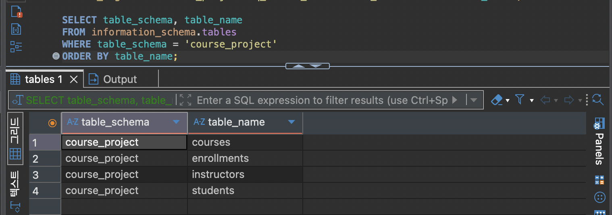
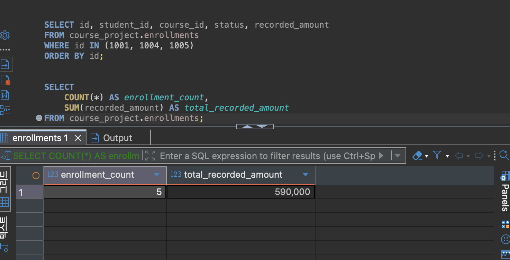
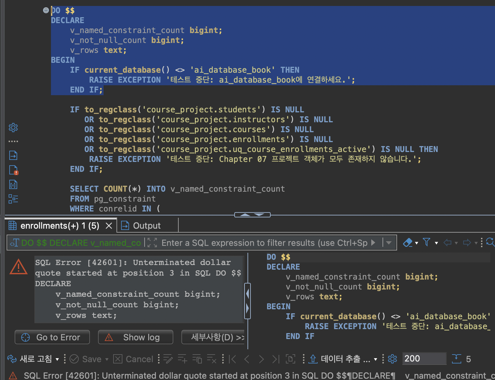
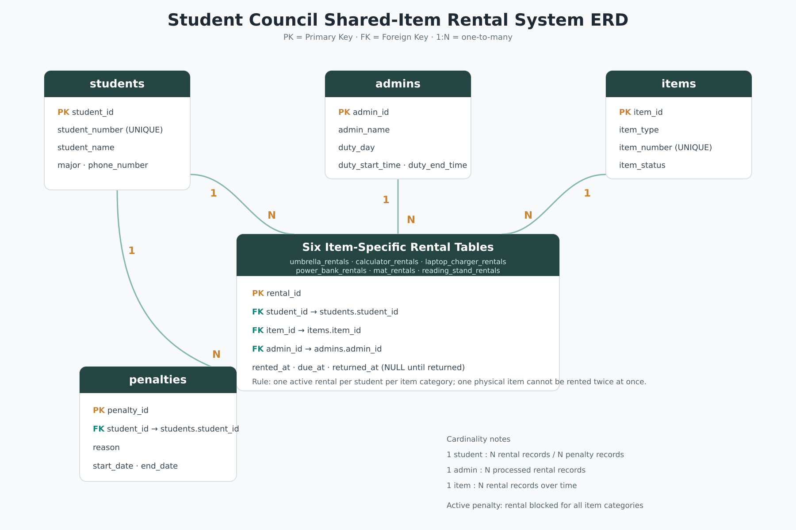

# Chapter 07 확장 실습 답안

> **과제:** 실전 프로젝트 1 — 온라인 강의 수강신청 DB 완성하기  
> **사용 방법:** 이 파일을 내려받아 본인의 GitHub 저장소에 `chapter07_answer.md`라는 이름으로 저장한 뒤 실습하면서 바로 작성합니다.  
> **제출 방법:** LMS에는 파일을 직접 업로드하지 않고, **본인 GitHub 저장소의 `chapter07_answer.md` 파일 URL**을 제출합니다.

---

## 제출 전 주의

이 파일과 캡처 화면에는 실제 비밀번호, 전체 DB 접속 URL, API Key, 개인정보를 기록하지 않습니다.

```text
GitHub 계정 또는 별칭: seohee0233
과제 작성일: 2026-10-27
사용한 AI 도구: ChapGPT
```

---

# 1. 시작 환경 확인

다음을 실행합니다.

```sql
SELECT current_database();
SELECT current_user;
SELECT current_schema();
SHOW search_path;
SHOW transaction_read_only;
```

| 확인 항목 | 실제 결과 | 의미 |
| --- | --- | --- |
| `current_database()` | ai_database_book | 현재 DB이름 |
| `current_user` | postgres | 유저 이름 |
| `current_schema()` | public | public 스키마 |
| `search_path` | public, "$user" | public에서 찾음 |
| `transaction_read_only` | off | 수정 가능 |

- [v] 현재 DB가 `ai_database_book`이다.
- [v] 쓰기 가능한 연결인지 확인했다.
- [v] 실행할 SQL 범위를 확인했다.
- [v] Auto-commit 상태를 확인했다.

### 프로젝트 SQL을 실행하기 전에 시작 상태를 확인해야 하는 이유

```text
엉뚱한 곳에 연결하면 연결이 되지 않거나, 원하는 방향으로 안 이루어질 수 있음
```

---

# 2. 프로젝트 범위와 요구사항 읽기

## 2-1. 포함 범위

본문을 그대로 복사하지 말고 자신의 말로 정리합니다.

```text
1. 학생 정보
2. 수강신청 방법
3. 강사 정보
4. 강의 정보
```

## 2-2. 제외 범위

```text
1. 실제 결제가 되었는지
2. 강의 정원
3. 진도
4. 할인 가능 여부 및 금액
```

### 범위를 명확하게 정해야 하는 이유

```text
 불필요한 테이블이나 규칙을 추가하지 않고, 정해진 범위 안에서 완성 여부를 확인할 수 있기 때문이다.
```

## 2-3. 요구사항 / 프로젝트 결정 / 미확정 질문 구분

아래 항목 중 대표 항목을 정리합니다.

| ID | 종류 | 내용 요약 | DB 구조/규칙에 미치는 영향 |
| --- | --- | --- | --- |
| P07-R01 | 요구사항 | 학생 정보를 저장하고 관리한다. | 학생 한 명을 저장하는 `students` 테이블이 필요하다. |
| P07-R05 | 요구사항 | 강의는 담당 강사와 연결되어야 한다. | `courses`에 강사를 참조하는 FK가 필요하다. |
| P07-R07 | 요구사항 | 수강신청에는 신청 상태와 신청 당시 기록 금액을 저장한다. | `enrollments`에 상태와 `recorded_amount` 열이 필요하다. |
| P07-D02 | 프로젝트 결정 | 신청 당시 금액은 신청 시점의 강의 기준 가격을 기록한다. | 신청을 만들 때 `courses.price` 값을 `enrollments.recorded_amount`에 저장한다. |
| P07-D03 | 프로젝트 결정 | 진행 중인 중복 신청은 허용하지 않는다. | 활성 상태의 중복 신청을 막는 부분 고유 인덱스가 필요하다. |
| P07-Q01 | 미확정 질문 | 학생과 강사 사이에서도 이메일을 전역 고유하게 제한할 것인가? | 정책이 정해지기 전에는 두 테이블을 아우르는 고유 규칙을 확정하지 않는다. |

### 미확정 질문을 바로 제약조건으로 만들면 안 되는 이유

```text
곧바로 제약조건으로 만들면 실제 요구사항과 다를 수 있기 때문에, 담당자나 서비스 정책을 확인한 뒤 적용해야 한다.
```

---

# 3. 네 테이블의 한 행 의미와 관계

## 3-1. 한 행 의미

```text
course_project.students 한 행 = 학생 한명

course_project.instructors 한 행 = 교수 한 명

course_project.courses 한 행 = 개설된 강의 한 개

course_project.enrollments 한 행 = 특정 학생이 특정 강의에 신청한 사건 한 건
```

## 3-2. 키와 중요 규칙

| 테이블 | PK | FK | 중요 규칙 |
| --- | --- | --- | --- |
| students | `id` | 없음 | 이메일은 필수이고 중복되면 안 된다. |
| instructors | `id` | 없음 | 이메일은 필수이고 중복되면 안 된다. |
| courses | `id` | `instructor_id` | 강의는 담당 강사를 한 명 참조한다. 가격은 0 이상이어야 한다. |
| enrollments | `id` | `student_id`, `course_id` | 신청 상태와 금액을 저장하고, 진행 중인 중복 신청은 허용하지 않는다. |

## 3-3. 관계를 양방향 문장으로 작성

```text
instructors ↔ courses:
강사 한 명은 여러 강의를 맡을 수 있고, 강의 하나는 한 명의 강사를 참조한다.

students ↔ enrollments:
학생 한 명은 여러 번 신청할 수 있고, 신청 하나는 한 명의 학생에게 속한다.

courses ↔ enrollments:
강의 하나에는 여러 신청이 있을 수 있고, 신청 하나는 한 강의를 참조한다.
```

### 학생과 강의의 N:M 관계가 `enrollments`를 통해 어떻게 바뀌는지 설명

```text
학생과 강의의 N:M 관계를 enrollments가 이어 준다. 그래서 학생은 여러 강의를 신청하고, 강의도 여러 학생의 신청을 받을 수 있다.
```

### `enrollments`가 단순 연결 테이블이 아니라 사건 테이블이라고 볼 수 있는 이유

```text
학생과 강의를 연결하는 것뿐 아니라 신청 날짜, 상태, 신청 당시 금액도 함께 기록하기 때문이다.
```

---

# 4. `recorded_amount`의 의미 이해

```text

courses.price → 현재 강의 기준 가격

enrollments.recorded_amount → 신청이 만들어질 때 해당 신청 행에 기록한 금액
```

### 두 값이 처음에는 같아도 같은 의미가 아닌 이유

```text
courses.price는 현재 강의 가격이고, recorded_amount는 신청 당시 금액이라서 의미가 다르다. 가격이 나중에 바뀌어도 신청 당시 금액은 그대로 남는다.
```

### `recorded_amount`를 실제 결제 성공액이나 회계 매출로 해석하면 안 되는 이유

```text
신청할 때 기록한 금액이라서 실제 결제가 승인됐는지나 환불됐는지는 기록하지 않기 때문이다.
```

---

# 5. STEP 01 — 스키마와 테이블 생성

실행 파일:

```text
code/chapter07/01_course_project_schema.sql
```

## 5-1. 실행 전 예상

```text
course_project 스키마 존재 여부: O
예상 테이블 수: 4
예상 데이터 행 수: 0  
예상되는 명명 제약조건 수: 15
예상되는 NOT NULL 열 수: 20
부분 고유 인덱스 존재 여부: O
```

## 5-2. 실행 결과

```text
실제 테이블 수: 4
실제 명명 제약조건 수: 15
실제 NOT NULL 열 수: 20
부분 고유 인덱스: O
네 테이블의 실제 행 수: 0
통과 메시지: Chapter 07 course project schema creation passed
```

### 예상과 실제 비교

```text
동일
```

### 증거 화면

권장 경로:

```text
assignments/chapter07/images/step05_schema.png
```



---

# 6. STEP 02 — Seed 데이터 입력

실행 파일:

```text
code/chapter07/02_course_project_seed.sql
```

## 6-1. 실행 전 예상

```text
students = 3
instructors = 2
courses = 3
enrollments = 4
recorded_amount 합계 = 470000
학생 101 신청 = 2
강의 301 신청 = 2
강사 201 강의 = 2
활성 중복 = 0
1001 = 수강중
1004 = 신청
1005 = 없음
```

## 6-2. 실제 결과

```text
students: 3
instructors: 2
courses: 3
enrollments: 4
recorded_amount 합계: 47000
학생 101 신청 건수: 2
강의 301 신청 건수: 
강사 201 담당 강의 수: 2
활성 중복 신청: 0
1001 상태: 수강중
1004 상태: 신청
1005 존재 여부: 없음
통과 메시지: Chapter 07 course project seed passed
```

### Seed 데이터를 단순 예제가 아니라 검증 데이터라고 볼 수 있는 이유

```text
1:N관계가 실제로 만들었는지, 같은 학생이 여러 신청이 가능한지, 같은 강의에 여러 학생이 신청 가능한지 등을 검사하는 데이터다.
```

---

# 7. STEP 03 — 변경 시나리오 실행

실행 파일:

```text
code/chapter07/03_course_project_changes.sql
```

## 7-1. 실행 전에 상태 변화를 예상

| 신청 ID | 변경 전 예상 상태 | 변경 후 예상 상태 | 예상 recorded_amount |
| ---: | --- | --- | ---: |
| 1001 | 수강중 | 완료 | 100000 |
| 1004 | 신청 | 취소 | 150000 |
| 1005 | 없음 | 신청 | 120000 |

```text
변경 후 예상 enrollments 행 수: 5
변경 후 예상 전체 recorded_amount 합계: 590000
변경 후 예상 취소 제외 건수: 4
변경 후 예상 취소 제외 recorded_amount 합계: 440000
```

## 7-2. 실제 결과

```text
1001 상태 / recorded_amount: 완료/100000
1004 상태 / recorded_amount: 취소/150000
1005 상태 / recorded_amount: 신청/120000
최종 enrollments 행 수: 5
전체 recorded_amount 합계: 590000 
취소 제외 건수: 4
취소 제외 recorded_amount 합계: 440000
활성 중복 신청: O
통과 메시지: Chapter 07 course project changes passed
```

### 조건부 UPDATE에서 예상 이전 상태를 확인해야 하는 이유

```text
예상과 다른 상태의 데이터를 실수로 덮어쓰지 않도록, 변경 전에 현재 상태가 맞는지 확인해야 한다.
```

### 증거 화면

권장 경로:

```text
assignments/chapter07/images/step07_changes.png
```



---

# 8. STEP 04 — 최종 완료 게이트 실행

실행 파일:

```text
code/chapter07/04_course_project_validation.sql
```

## 8-1. 최종 검증 결과

```text
최종 행 수 students/instructors/courses/enrollments: 3 / 2 / 3 / 5
서비스 JOIN 결과 행 수: 5
학생 101 신청 수: 2
강의 301 신청 수: 2
강사 201 강의 수: 2
고아 관계 수: 0
활성 중복 신청 수: 0
전체 recorded_amount: 590000
취소 제외 recorded_amount: 440000
통과 메시지: Chapter 07 course project validation passed
```

### SQL 파일 4개가 모두 실행되었다는 사실과 프로젝트 검증 PASS가 다른 이유

```text
SQL 파일이 실행됐어도 구조나 데이터가 요구사항과 다를 수 있다. 검증 SQL은 행 수, 관계, 상태와 금액 등이 예상대로인지 확인해 PASS로 알려 준다.
```

### 증거 화면

권장 경로:

```text
assignments/chapter07/images/step08_validation.png
```

!

---

# 9. 무결성 테스트

실행 파일:

```text
code/chapter07/05_course_project_integrity_tests.sql
```

> 오류 테스트는 파일 전체를 무작정 실행하지 않고 **한 테스트 구간씩** 실행합니다.

## 9-1. 허용되어야 하는 경계값 1개

```text
테스트 내용: 가격과 신청 금액을 0으로 입력하고, 설명을 NULL로 입력
기대 결과: 성공
실제 결과: 임시 데이터가 입력됨
왜 허용되어야 하는가: 무료 강의도 있을 수 있고, 설명은 필수 정보가 아니기 때문이다.
```

## 9-2. 실패해야 하는 테스트 1 — 잘못된 참조 또는 값

```text
테스트 내용: 존재하지 않는 강사 ID(999)를 강의에 입력
기대 결과: 실패
실제 오류 핵심: 참조하려는 강사 ID가 존재하지 않는다는 오류
동작한 제약조건/규칙: fk_course_courses_instructor
왜 실패해야 하는가: 강의가 존재하지 않는 강사를 참조하면 안 되기 때문이다.
```

## 9-3. 실패해야 하는 테스트 2 — 활성 중복 신청

```text
테스트 내용: 이미 활성 신청이 있는 학생 101이 강의 302에 다시 신청
기대 결과: 실패
실제 오류 핵심: 중복 키 값이 이미 존재한다는 오류
동작한 인덱스/규칙: uq_course_enrollments_active
왜 실패해야 하는가: 같은 학생이 같은 강의에 활성 신청을 중복으로 할 수 없기 때문이다.
```

## 9-4. 실패 후 기준 상태 재검증

```text
04 validation 재실행 결과: Chapter 07 course project validation passed
기준 데이터가 유지되었는가: Y
```

### 실패 테스트가 프로젝트 품질 검증에 필요한 이유

```text
잘못된 데이터가 실제로 차단되는지 확인하고, 테스트 후에도 기준 데이터가 그대로인지 확인할 수 있기 때문이다.
```

### 증거 화면

권장 경로:

```text
assignments/chapter07/images/step09_integrity.png
```



---

# 10. 재현성 실험

> 이 단계는 본인의 실습 환경이며 보존할 데이터가 없을 때만 수행합니다.

실행 순서:

```text
reset_course_project.sql
→ 01_course_project_schema.sql
→ 02_course_project_seed.sql
→ 03_course_project_changes.sql
→ 04_course_project_validation.sql
```

```text
처음 실행의 최종 결과: Chapter 07 course project validation passed
재실행의 최종 결과: Chapter 07 course project validation passed
두 결과가 일치했는가: Y
중간에 수동 수정이 필요했는가: N
```

### 다른 사람이 같은 순서로 실행해 같은 결과를 얻는 것이 중요한 이유

```text
사용환경에 따라서 변화하지 않는다는 뜻이기 때문이다. 
```

---

# 11. Chapter 01~06 개인 프로젝트를 중간 프로젝트 초안으로 확장

## 11-1. 프로젝트 기본 정보

```text
프로젝트 이름: 경영대 학생회 공용물품 대여 관리 시스템

해결하려는 문제: 학생회에서 우산, 계산기 등 공용물품의 대여·반납·연체를 수기로 관리할 때 생기는 혼선과 중복 대여 문제를 줄인다.

주요 사용자: 공용물품을 대여하는 학생과 대여를 관리하는 학생회 관리자
```

## 11-2. 포함 범위 / 제외 범위

```text
[포함]
1. 학생 정보와 관리자 정보 관리
2. 우산, 계산기, 노트북 충전기, 보조배터리, 돗자리, 독서대 관리
3. 품목별 대여 및 반납 기록 관리
4. 연체 학생의 7일 대여 제한 관리

[제외]
1. 온라인 결제 기능
2. 문자 또는 앱 알림 발송 기능
3. 실제 학생회 로그인 및 권한 관리 기능
```

## 11-3. 요구사항

| ID | 요구사항 | 관련 테이블/관계 | 검증 방법 후보 |
| --- | --- | --- | --- |
| P07-MR01 | 학생의 학번, 이름, 학과, 연락처를 저장한다. | `students` | 학생 정보를 입력하고 조회한다. |
| P07-MR02 | 실제 물품마다 품목 종류, 물품 번호, 현재 상태를 저장한다. | `items` | 계산기 1번과 계산기 2번을 별도 물품으로 입력한다. |
| P07-MR03 | 학생은 물품을 대여하고 반납할 수 있으며, 대여 기록을 남긴다. | 품목별 대여 테이블, `students`, `items` | 대여일과 반납일이 포함된 대여 기록을 입력한다. |
| P07-MR04 | 대여 기록은 대여 학생, 실제 물품, 처리 관리자를 연결한다. | 품목별 대여 테이블의 FK | 존재하지 않는 학생·물품·관리자로 대여를 등록할 수 없는지 확인한다. |
| P07-MR05 | 한 학생은 서로 다른 품목을 각각 하나씩 대여할 수 있다. | 품목별 대여 테이블 | 학생 한 명이 우산과 계산기를 함께 대여할 수 있는지 확인한다. |
| P07-MR06 | 한 학생은 같은 품목을 반납 전 두 개 이상 대여할 수 없다. | 품목별 대여 테이블 | 계산기를 대여 중인 학생이 계산기를 다시 대여하려 할 때 막히는지 확인한다. |
| P07-MR07 | 실제 물품 한 개는 동시에 한 학생에게만 대여할 수 있다. | `items`와 품목별 대여 테이블 | 계산기 1번을 대여 중일 때 다른 학생에게 다시 대여할 수 없는지 확인한다. |
| P07-MR08 | 연체 학생은 모든 품목을 7일 동안 대여할 수 없으며, 패널티 기록은 남긴다. | `penalties`, `students` | 패널티 기간에는 대여가 막히고, 기간이 지나면 다시 대여되는지 확인한다. |

## 11-4. 프로젝트 결정

| ID | 이번 프로젝트에서 내린 결정 | 이유 | 구현 후보 |
| --- | --- | --- | --- |
| P07-MD01 | 품목별 대여 테이블을 6개로 나눈다. | 품목별 대여 현황을 구분해서 관리하고, 프로젝트에서 다양한 테이블 관계를 사용하기 위해서이다. | `umbrella_rentals`, `calculator_rentals` 등 6개 테이블 |
| P07-MD02 | 반납한 대여 기록은 삭제하지 않고 `returned_at`에 반납일을 저장한다. | 같은 물품을 나중에 다시 대여할 수 있어야 하고, 과거 대여 기록도 확인해야 하기 때문이다. | `returned_at` 컬럼 |
| P07-MD03 | 패널티가 끝나도 패널티 기록은 삭제하지 않는다. | 현재 대여 제한은 끝나더라도 과거 연체 이력은 확인할 수 있어야 하기 때문이다. | `penalties.start_date`, `penalties.end_date` |

## 11-5. 미확정 질문

```text
P07-MQ01. 품목별 대여 기간을 모두 같게 할지, 다르게 할지 아직 정하지 않았다.

P07-MQ02. 연체 7일 제한을 반납 예정일 다음 날부터 적용할지, 실제 반납일부터 적용할지 아직 정하지 않았다.

P07-MQ03. 대여가 거절된 시도도 별도의 기록으로 저장할지 아직 정하지 않았다.
```

---

# 12. 개인 프로젝트 ERD와 한 행 의미

## 12-1. 테이블 후보

| 테이블 | 한 행의 의미 | PK 후보 | FK 후보 | 주요 규칙 |
| --- | --- | --- | --- | --- |
| `students` | 학생 한 명의 기본 정보 | `student_id` | 없음 | 학번은 중복될 수 없다. |
| `admins` | 학생회 관리자 한 명의 정보 | `admin_id` | 없음 | 담당 요일과 담당 시간을 저장한다. |
| `items` | 실제 공용물품 한 개의 정보 | `item_id` | 없음 | 물품 번호는 중복될 수 없다. |
| 품목별 대여 테이블 6개 | 학생 한 명이 실제 물품 한 개를 한 번 대여한 기록 | `rental_id` | `student_id`, `item_id`, `admin_id` | 반납 전에는 `returned_at`이 비어 있다. |
| `penalties` | 학생 한 명에게 발생한 연체 제한 한 건의 기록 | `penalty_id` | `student_id` | 시작일과 종료일을 저장한다. |

## 12-2. 관계 문장

```text
1. 학생 한 명은 여러 번의 대여 기록을 가질 수 있고, 대여 기록 한 건은 한 명의 학생에게만 속한다.

2. 실제 물품 한 개는 시간에 따라 여러 번 대여될 수 있고, 대여 기록 한 건은 한 개의 실제 물품에만 속한다.

3. 학생 한 명은 여러 건의 패널티 기록을 가질 수 있고, 패널티 기록 한 건은 한 명의 학생에게만 속한다.
```

## 12-3. ERD





### Chapter 05~06 ERD에서 이번에 바꾼 점

```text
학생 정보와 대여 정보를 분리하여 중복 저장하지 않도록 정리했다.

반납 여부를 글자로 저장하는 대신 returned_at 컬럼을 사용하도록 했다.
반납 전에는 NULL이고, 반납 후에는 실제 반납일을 저장한다.

연체 제한은 대여 테이블에 섞지 않고 penalties 테이블로 분리했다.
패널티가 끝나도 기록은 남기고 종료일을 기준으로 현재 제한 여부를 판단한다.
```

---

# 13. 개인 프로젝트 완료 기준 만들기

| 번호 | 완료 기준 | 자동 SQL 검증 가능? | 검증 방법 |
| ---: | --- | --- | --- |
| 1 | 학생 학번이 중복 입력되지 않는다. | 가능 | 같은 학번으로 학생을 두 번 입력해 오류가 발생하는지 확인한다. |
| 2 | 존재하지 않는 학생, 물품, 관리자를 참조하는 대여 기록은 입력되지 않는다. | 가능 | 없는 FK 값으로 대여 기록을 입력해 오류가 발생하는지 확인한다. |
| 3 | 한 학생이 서로 다른 품목을 각각 대여할 수 있다. | 가능 | 한 학생에게 우산과 계산기 대여 기록을 각각 입력한다. |
| 4 | 한 학생이 같은 품목을 반납 전 두 번 대여할 수 없다. | 가능 | 반납 전인 학생에게 같은 품목의 대여 기록을 다시 입력해 본다. |
| 5 | 실제 물품 한 개가 동시에 두 학생에게 대여되지 않는다. | 가능 | 대여 중인 계산기 1번을 다른 학생에게 대여하려고 한다. |
| 6 | 패널티 기간 안에는 모든 품목의 대여가 제한된다. | 가능 | 패널티 종료일이 지나지 않은 학생의 대여 등록이 막히는지 확인한다. |
| 7 | 패널티 종료일이 지나면 다시 대여할 수 있고, 과거 패널티 기록은 남아 있다. | 가능 | 종료일이 지난 학생의 대여 등록과 패널티 조회를 함께 확인한다. |

---

# 14. AI를 프로젝트 리뷰어로 사용

## 14-1. AI에게 전달한 핵심 자료

```text
요구사항:
학생은 서로 다른 품목을 각각 하나씩 대여할 수 있다.
하지만 같은 품목은 반납 전 두 개 이상 대여할 수 없다.
실제 물품 한 개도 동시에 두 학생에게 대여될 수 없다.
연체 학생은 모든 품목을 7일 동안 대여할 수 없다.

테이블/ERD 설명:
students, admins, items, 품목별 대여 테이블 6개, penalties 테이블을 사용한다.
대여 테이블은 student_id, item_id, admin_id, rented_at, due_at, returned_at을 가진다.

프로젝트 결정:
품목별 대여 테이블을 분리한다.
반납 기록과 패널티 기록은 삭제하지 않고 남긴다.

미확정 질문:
품목별 정확한 대여 기간과 연체 제한 시작일은 아직 정하지 않았다.

완료 기준:
학번 중복, 잘못된 FK, 중복 대여, 연체 제한이 제대로 막히는지 SQL로 확인한다.
```

## 14-2. 내가 사용한 프롬프트

```text
나는 PostgreSQL 초보자야.
경영대 학생회 공용물품 대여 관리 시스템을 설계하고 있다.

아래 요구사항과 ERD를 보고, 중복 저장, 잘못된 관계, DB 제약조건으로 막아야 하는 규칙, 그리고 SQL로 검증해야 하는 부분을 찾아줘.

아직 정하지 않은 정책은 임의로 확정하지 말고 질문으로 남겨줘.
```

## 14-3. AI 제안 검토

| AI 제안 | 수용 / 수정 / 보류 / 거절 | 실제 근거 | 반영 내용 |
| --- | --- | --- | --- |
| 대여 테이블에서 학생 이름과 학과를 빼고 학생 ID로 연결 | 수용 | P07-MR01, P07-MR03 | 학생 정보는 `students` 테이블에서만 관리한다. |
| 반납 여부를 문자로 저장하지 말고 `returned_at`을 사용 | 수용 | P07-MR03 | 반납 전에는 NULL, 반납 후에는 실제 반납일을 저장한다. |
| 패널티 종료 후 기록을 삭제하지 말고 종료일을 저장 | 수용 | P07-MR08 | `penalties` 테이블에 과거 연체 기록을 남긴다. |
| 모든 품목의 대여 테이블을 하나의 `rentals` 테이블로 통합 | 거절 | P07-MD01 | 이번 프로젝트에서는 품목별 대여 테이블 6개를 유지한다. |

### AI가 미확정 정책을 임의로 확정하려 한 부분이 있었나요?

```text
AI가 품목별 대여 기간이나 연체 제한 시작일을 하나의 방식으로 정할 수 있다고 제안한 적이 있었다.
하지만 이 내용은 아직 학생회 운영 기준으로 확정되지 않았으므로, 제약조건으로 만들지 않고 미확정 질문으로 남겼다.
```

### AI가 제안한 규칙 중 아직 배우지 않은 기능이라 보류한 것이 있나요?

```text
반납 전인 대여 기록만 대상으로 중복을 막는 부분 UNIQUE 인덱스와 패널티를 자동으로 확인하는 트리거는 아직 배우지 않은 기능이므로 보류했다.
```

### AI 활용 후 실제로 좋아진 부분

```text
학생 정보, 대여 기록, 패널티 기록의 역할을 분리할 수 있었다.
```

---

# 15. 최종 성찰

아래 문장은 반드시 본인의 말로 작성합니다.

```text
데이터베이스 프로젝트가 완료되었다고 판단하려면 SQL 파일의 존재보다 요구사항대로 데이터가 만들어지고 검증됐는지가 중요하다.

Seed 데이터의 목적은 단순히 화면을 채우는 것이 아니라 관계와 규칙이 제대로 동작하는지 확인하는 것이다.

실패 테스트가 필요한 이유는 잘못된 데이터가 실제로 차단되는지 확인하기 위해서다.

요구사항과 프로젝트 결정을 구분해야 하는 이유는 필수 규칙과 이번 프로젝트에서 선택한 규칙을 구별하기 위해서다.

내가 만든 개인 프로젝트에서 가장 먼저 추가 확인해야 할 정책은 같은 대상에 중복으로 신청하거나 예약할 수 있는지 여부다.
```

---

# 16. 제출 체크리스트

- [V] `chapter07_answer.md`를 본인 저장소에 만들었다.
- [V] 시작 환경과 현재 DB를 확인했다.
- [V] 프로젝트 포함/제외 범위를 설명했다.
- [V] 요구사항/결정/미확정 질문을 구분했다.
- [V] 네 테이블의 한 행 의미와 관계를 설명했다.
- [V] `01_course_project_schema.sql`을 실행하고 결과를 확인했다.
- [V] `02_course_project_seed.sql`의 기준 상태를 확인했다.
- [V] `03_course_project_changes.sql` 전후 상태를 비교했다.
- [V] `04_course_project_validation.sql` PASS를 확인했다.
- [V] 허용 경계값 1개 이상을 확인했다.
- [V] 실패 테스트 2개 이상을 한 구간씩 실행했다.
- [V] 실패 후 validation을 다시 실행했다.
- [V] 개인 프로젝트 요구사항 8개 이상을 작성했다.
- [V] 프로젝트 결정 3개 이상과 미확정 질문 3개 이상을 작성했다.
- [V] 개인 프로젝트 ERD를 작성했다.
- [V] 검증 가능한 완료 기준 6개 이상을 작성했다.
- [V] AI 제안을 수용/수정/보류/거절로 구분했다.
- [V] 핵심 캡처는 3~4장 정도로 정리했다.
- [V] 캡처에 비밀번호나 개인정보가 없다.
- [V] GitHub 웹에서 Markdown과 이미지가 정상적으로 보인다.
- [V] 최종 파일을 commit/push했다.

---

# 17. LMS 제출 URL

아래 형식의 **본인 GitHub 파일 URL**을 LMS에 제출합니다.

```text
https://github.com/<본인-GitHub-ID>/<본인-저장소>/blob/main/assignments/chapter07/chapter07_answer.md
```

내 제출 URL:

```text
https://github.com/seohee0233/ai-database-study/blob/main/assignments/chapter07/chapter07_answer.md
```

> 저장소 메인 URL, 교수자 템플릿 URL, Raw URL이 아니라 **작성 완료된 본인 `chapter07_answer.md` 파일 화면 URL**을 제출합니다.
