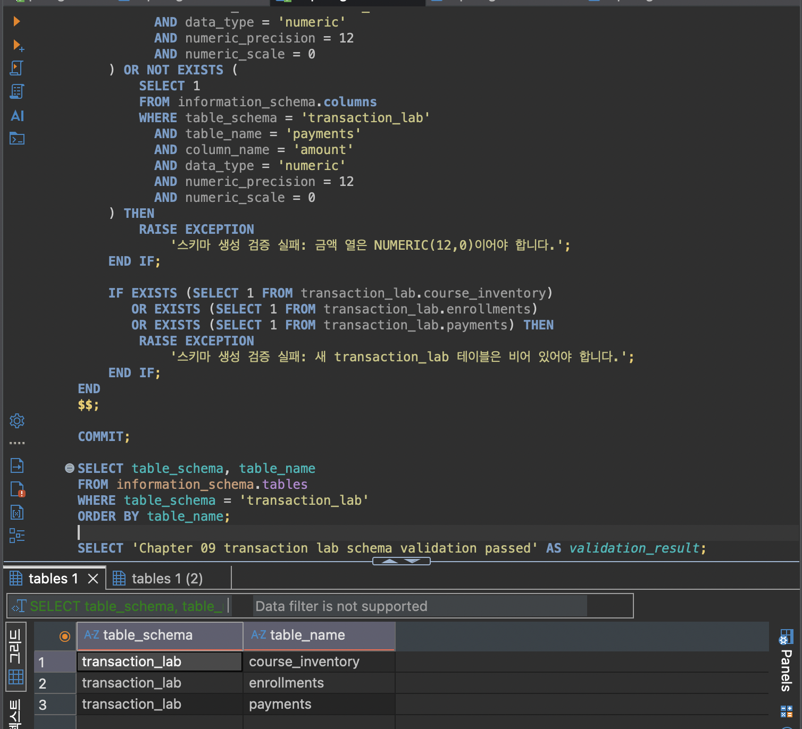
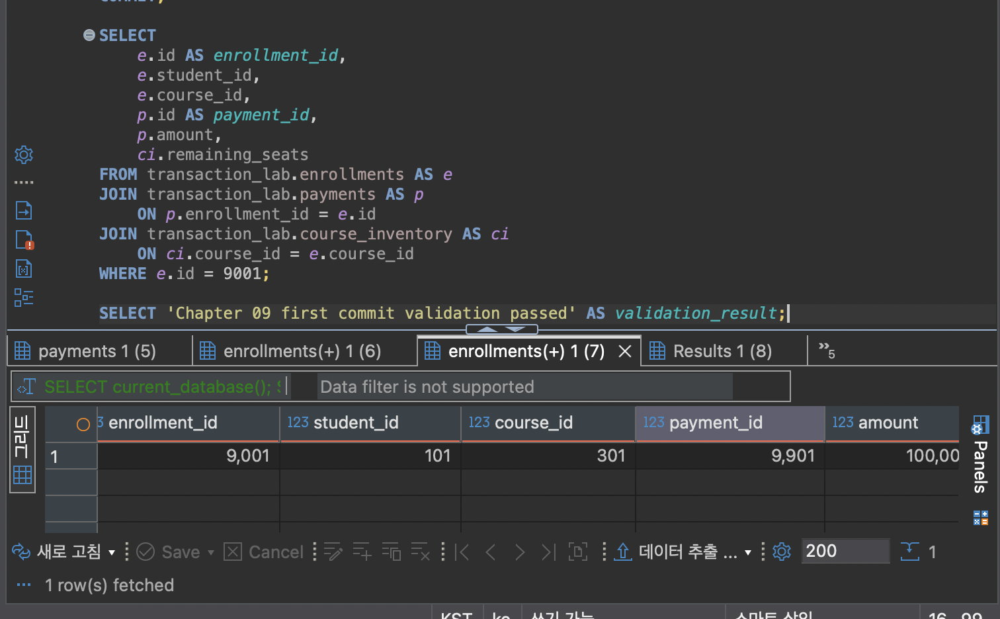

# Chapter 09 확장 실습 답안

> **과제:** 트랜잭션으로 데이터 정합성 지키기  

---

## 제출 전 주의

이 파일과 캡처 화면에는 실제 비밀번호, 전체 DB 접속 URL, API Key, 개인정보를 기록하지 않습니다.

```text
GitHub 계정 또는 별칭: seohee0233
과제 작성일: 2026-11-12
사용한 AI 도구: ChatGPT
```

---

# 1. 시작 환경과 Chapter 07·08 기준 상태 확인

다음을 실행하거나 Chapter 09의 `01_transaction_lab_schema.sql` 사전 검사를 확인합니다.

```sql
SELECT current_database(); ai_database_book
SELECT current_user; postgres
SELECT current_schema(); public
SHOW search_path; public, "$user"
SHOW transaction_read_only; off
```

| 확인 항목 | 실제 결과 | 의미 |
| --- | --- | --- |
| `current_database()` | `ai_database_book` | 현재 연결된 데이터베이스가 실습 대상 DB인지 확인한다 |
| `current_user` | `postgres` | 사용자 계정 |
| `current_schema()` | `public` | 기본으로 사용하는 스키마 |
| `search_path` | `public, "$user"` | PostgreSQL이 테이블·객체를 찾을 스키마 순서 |
| `transaction_read_only` | `off` | 읽기 전용 모드가 꺼져 있어 데이터 변경 가능 |


Chapter 07·08 기준값:

```text
students = 3
instructors = 2
courses = 3
enrollments = 5
전체 recorded_amount = 590000
활성 = 3 / 340000
취소 제외 = 4 / 440000
```

### 기준 상태가 다르면 Chapter 09를 계속 진행하면 안 되는 이유

```text
course_project는 앞 장의 기준 데이터를 유지하기 때문에 transaction_lab만 좌석·신청·결제 트랜잭션 실험에 사용한다.
```

---

# 2. `transaction_lab` 스키마 생성

실행 파일:

```text
code/chapter09/01_transaction_lab_schema.sql
```

## 2-1. 생성 전 예상

```text
생성될 스키마: transaction_lab

생성될 테이블 3개:
transaction_lab.course_inventory
transaction_lab.enrollments
transaction_lab.payments

course_inventory 한 행의 의미: 특정 강의의 좌석 상태 한 건

enrollments 한 행의 의미: transaction_lab에서 생성한 수강신청 사건 한 건

payments 한 행의 의미: 특정 transaction_lab 수강신청에 연결된 결제 기록 한 건
```

## 2-2. 생성 결과

```text
통과 메시지: Chapter 09 transaction lab schema validation passed
```

기대 메시지:

```text
Chapter 09 transaction lab schema validation passed
```

### Chapter 07·08의 `course_project`와 별도 `transaction_lab`을 사용하는 이유

```text
기존 프로젝트 데이터를 보호하면서 Chapter 09의 변경 실험을 분리하기 위해서.
```

### 증거 화면

권장 경로:

```text
assignments/chapter09/images/step02_schema.png
```



---

# 3. 초기 좌석과 기준 데이터 입력

실행 파일:

```text
code/chapter09/02_transaction_lab_seed.sql
```

## 3-1. 실행 전 예상

```text
course 301 remaining_seats 예상: 2
course 302 remaining_seats 예상: 1
course 303 remaining_seats 예상: 1
lab enrollments 예상 행 수: 0
payments 예상 행 수: 0
```

## 3-2. 실제 결과

```text
course 301 remaining_seats: 2 
course 302 remaining_seats: 1
course 303 remaining_seats: 1
lab enrollments 행 수: 0
payments 행 수: 0
통과 메시지: Chapter 09 transaction lab seed validation passed
```

기대 초기 상태:

```text
course 301 / 302 / 303 remaining_seats = 2 / 1 / 1
lab enrollments = 0
payments = 0
```

### 예상과 실제가 다른 경우 원인

```text
블로그에는 3,0,0으로 되어 있으나, sql을 보면 2,1,1이 맞음
```

---

# 4. 첫 번째 정상 COMMIT 추적

실행 파일:

```text
code/chapter09/03_commit_transaction.sql
```

이 실습은 학생 101이 강의 301을 신청하는 하나의 업무 단위를 추적합니다.

## 4-1. 업무 단위 정의

```text
이 트랜잭션에서 함께 성공해야 하는 변경 1: 강의 301의 남은 좌석을 1개 감소시킨다.

변경 2: 학생 101의 강의 301 수강신청을 생성한다.

변경 3: 해당 수강신청에 연결된 결제 기록을 생성한다.

하나라도 실패하면 전체를 취소해야 하는 이유: 좌석만 줄거나 신청만 생성되는 등 좌석·신청·결제 상태가 서로 맞지 않게 될 수 있기 때문이다.
```

## 4-2. 상태 변화 기록

| 시점 | course 301 남은 좌석 | lab enrollment 9001 | payment 9901 | 설명 |
| --- | ---: | --- | --- | --- |
| BEGIN 전 | 2 | 없음 | 없음 | 초기 상태 |
| 트랜잭션 내부 | 1 | 생성됨: 학생 101·강의 301, 금액 100,000 | 생성됨: 금액 100,000 | COMMIT 전 변경 상태 |
| COMMIT 후 | 1 | 생성됨 | 생성됨 | 변경 사항이 확정됨 |

## 4-3. COMMIT 조건

```text
좌석 UPDATE 기대 영향 행 수: 1
실제 영향 행 수: 1
신청 생성 기대 행 수: 1
결제 생성 기대 행 수: 1
recorded_amount와 payment.amount 일치 여부: Y
최종 COMMIT 판단: 모든 변경이 1행씩 생성되고 금액과 최종 상태가 일치하므로 COMMIT
```

기대 메시지:

```text
Chapter 09 first commit validation passed
```

### SQL 오류가 없었다는 사실만으로 COMMIT하면 안 되는 이유

```text
업무가 의도한 대로 처리됐다는 보장은 없기 때문에
```

### 증거 화면

권장 경로:

```text
assignments/chapter09/images/step04_commit.png
```



---

# 5. ROLLBACK으로 전체 원상복구 확인

실행 파일:

```text
code/chapter09/04_rollback_transaction.sql
```

## 5-1. ROLLBACK 전 예상

```text
트랜잭션 안에서 임시로 바뀔 값: course 301 
ROLLBACK 후 다시 돌아와야 할 값: course 301의 남은 값
이미 이전 파일에서 COMMIT된 9001/9901은 유지되어야 하는가: Y 원래 있떤 파일이니까
```

## 5-2. 실제 결과

```text
ROLLBACK 후 course 301 상태: remaining_seats = 1
ROLLBACK 후 lab enrollments 행 수: 1
ROLLBACK 후 payments 행 수: 1
9001 존재 여부: 존재
9901 존재 여부: 존재
통과 메시지: Chapter 09 rollback validation passed
```

기대 메시지:

```text
Chapter 09 rollback validation passed
```

## 5-3. ROLLBACK과 IDENTITY

```text
ROLLBACK이 테이블 행 변경을 되돌리는 방식: 아직 COMMIT하지 않은 변경을 취소한다.

IDENTITY 자동 번호가 이전 값으로 돌아가지 않을 수 있는 이유: 번호는 데이터 변경과 따로 관리돼서 그렇다.

번호가 건너뛰어도 데이터 손상은 아닌 이유: 자동 번호는 고유하게 구분하려고 쓰는 값이라서 그렇다.
```

---

# 6. 두 번째 COMMIT과 좌석 부족 0행 관찰

실행 파일:

```text
code/chapter09/05_commit_and_sold_out.sql
```

## 6-1. 두 번째 정상 COMMIT

```text
생성된 enrollment id: 9002
학생 id: 103
course id: 302
recorded_amount: 120000
payment id: 9902
payment amount: 120000
```

## 6-2. 좌석 부족 시도

```text
좌석 확보 UPDATE 기대 영향 행 수: 0행
실제 영향 행 수: 0행
후속 enrollment 생성 행 수: 0행
후속 payment 생성 행 수: 0행
```

기준상 좌석 부족 시 생성되지 않아야 하는 ID:

```text
9003
9903
```

### `UPDATE 0`이 SQL 실패가 아니라 업무상 실패일 수 있는 이유

```text
SQL 문법은 맞지만 남은 좌석이 없어 좌석 확보에 실패한 것일 수 있음
```

### 영향 행 수가 0인데 신청과 결제를 계속 생성하면 어떤 정합성 문제가 생기나요?

```text
좌석은 확보되지 않았는데 신청과 결제만 생겨 데이터가 서로 맞지 않고, 정원보다 많은 신청이 생길 수 있다.
```

---

# 7. 주 실습 최종 정합성 검증

실행 파일:

```text
code/chapter09/06_transaction_validation.sql
```

## 7-1. lab 최종 상태

| 항목 | 기대값 | 실제값 | 일치? |
| --- | ---: | ---: | --- |
| course_inventory 행 수 | 3 | 3 | 일치 |
| lab enrollments 행 수 | 2 | 2 | 일치 |
| payments 행 수 | 2 | 2 | 일치 |
| course 301 remaining | 1 | 1 | 일치 |
| course 302 remaining | 0 | 0 | 일치 |
| course 303 remaining | 1 | 1 | 일치 |

## 7-2. 주요 행

```text
9001 = student 101 / course 301 / amount 100000 / payment 9901
실제: 일치

9002 = student 103 / course 302 / amount 120000 / payment 9902
실제: 일치

9003·9903 = 존재하지 않아야 함
실제: 존재하지 않음
```

## 7-3. 보호 대상 확인

```text
course_project.enrollments 행 수: 5
전체 recorded_amount: 590000
활성 건수/금액: 3건 / 340000
취소 제외 건수/금액: 4건 / 440000
```

기대값:

```text
course_project.enrollments = 5
전체 = 590000
활성 = 3 / 340000
취소 제외 = 4 / 440000
```

최종 기대 메시지:

```text
Chapter 09 main transaction validation passed
```

### transaction_lab 실습 후에도 course_project 기준 상태를 다시 검사하는 이유

```text
Chapter 09 실습 중 변경한 transaction_lab이 기존 course_project 데이터에 영향을 주지 않았는지 확인하기 위해서.
```

---

# 8. ACID를 이번 실습으로 설명

교과서 정의를 그대로 복사하지 말고 이번 좌석·신청·결제 사례로 작성합니다.

```text
Atomicity: 좌석 차감·신청·결제가 전부 성공하거나 전부 취소된다.

Consistency: 좌석 수와 신청·결제 정보가 서로 맞는 상태를 유지한다.

Isolation: 동시에 신청해도 같은 좌석을 두 사람이 중복으로 가져가지 않게 처리한다.

Durability: COMMIT된 신청과 결제는 이후에도 저장되어 있다.
```

### Atomicity와 Consistency가 같은 뜻이 아닌 이유

```text
Atomicity는 전부 성공하거나 전부 취소하는거고 consistency는 정보가 맞는 상태를 유지시키게 하는거다. 
```

---

# 9. 선택 실습 — 두 세션 Lock 대기 관찰

실행 파일:

```text
code/chapter09/07_concurrency_two_sessions.sql
```

가능하면 DBeaver에서 **서로 다른 두 연결 세션**으로 수행합니다.

## 9-1. 내 환경

```text
실제 두 세션 실습 수행 / 절차 분석만 수행:
transaction_isolation:
lock_timeout:
```

## 9-2. 시간 순서 기록

| 순서 | Session A | Session B | 관찰 |
| ---: | --- | --- | --- |
| 1 |  |  |  |
| 2 |  |  |  |
| 3 |  |  |  |
| 4 |  |  |  |

```text
먼저 Lock을 획득한 세션:
대기한 세션:
A가 COMMIT/ROLLBACK한 뒤 B에서 일어난 일:
```

### Lock 대기와 Deadlock의 차이

```text

```

### `SELECT ... FOR UPDATE`가 모든 UPDATE 앞에 항상 필요한 것은 아닌 이유

```text

```

### 증거 화면

실제 수행했다면 권장 경로:

```text
assignments/chapter09/images/step09_lock.png
```

---

# 10. 선택 실습 — 취소와 좌석 복구

실행 파일:

```text
code/chapter09/08_cancel_and_restore.sql
```

```text
9001 취소 성공 행 수:
course 301 좌석 변화:
같은 취소를 다시 시도한 행 수:
두 번째 좌석 복구 행 수:
payment 9901 유지 여부:
최종 ROLLBACK 후 원상복구 여부:
통과 메시지:
```

기대 흐름:

```text
9001 수강중 → 취소 1행
course 301 remaining 1 → 2
같은 취소 재시도 → 0행
추가 좌석 복구 → 0행
마지막 ROLLBACK → 주 실습 기준으로 복구
```

### 같은 취소를 두 번 처리해도 좌석이 두 번 증가하지 않아야 하는 이유

```text

```

---

# 11. 선택 실습 — 오류 상태와 SAVEPOINT

실행 파일:

```text
code/chapter09/09_error_and_savepoint.sql
```

## 11-1. 일반 오류 후 트랜잭션 상태

```text
발생시킨 오류:
오류 이후 다음 SQL 실행 결과:
전체 ROLLBACK이 필요한 이유:
```

## 11-2. SAVEPOINT 사용

```text
SAVEPOINT 이름:
오류 발생 위치:
ROLLBACK TO SAVEPOINT 후 상태:
이후 계속 실행할 수 있었는가:
```

### SAVEPOINT가 전체 ROLLBACK과 다른 점

```text

```

---

# 12. 개인 프로젝트 트랜잭션 시나리오 설계

Chapter 07에서 시작한 개인 프로젝트를 사용합니다.

둘 이상의 변경이 함께 성공해야 하는 업무를 **하나** 선택합니다.

예:

```text
대여 생성 + 대여 가능 상태 변경
```

## 12-1. 업무 정의

```text
시나리오 ID: P09-T01
업무 이름: 렌탈 물품 대여
사용자 행동: 경영대 학생이 대여 가능한 학생회 물품을 신청한다.
왜 하나의 트랜잭션이어야 하는가:
대여 기록만 생기거나 물품 상태만 ‘대여 중’으로 바뀌면 실제 상태와 기록이 달라지기 때문이다.
```

## 12-2. 트랜잭션 설계표

| 항목 | 내 설계 |
| --- | --- |
| BEGIN 전 확인 상태 | 신청 학생이 존재하는지, 물품이 대여 가능한 상태인지 확인 |
| 잠금/경쟁 가능 데이터 | 대여하려는 물품. 여러 학생이 동시에 신청할 수 있으므로 해당 물품 행을 잠금 |
| 변경 1 | 물품 상태를 ‘대여 가능’에서 ‘대여 중’으로 변경 |
| 기대 영향 행 수 | 1행 |
| 변경 2 | 학생과 물품을 연결한 대여 기록 생성 |
| 기대 영향 행 수 | 1행 |
| 추가 변경 | 반납 예정일 등 대여에 필요한 정보 기록 |
| COMMIT 전 검증 | 물품이 ‘대여 중’이고 해당 학생의 대여 기록이 생성됐는지 확인 |
| COMMIT 조건 | 물품 상태 변경과 대여 기록 생성이 각각 1행이고 정보가 일치하면 COMMIT |
| ROLLBACK 조건 | 물품을 대여할 수 없거나 상태 변경·대여 기록 생성 중 하나라도 실패하면 ROLLBACK |

## 12-3. 실패 시나리오

최소 두 개 작성합니다.

```text
실패 1: 이미 다른 학생이 대여한 물품을 신청함
어느 단계에서 발생: 물품 상태를 ‘대여 가능’에서 ‘대여 중’으로 바꾸는 단계
남으면 안 되는 부분 상태: 새 대여 기록
ROLLBACK 후 기대 상태: 물품은 기존 상태를 유지하고 새 대여 기록은 없어야 함

실패 2: 물품 상태 변경은 성공했지만 대여 기록 생성에 실패함
어느 단계에서 발생: 대여 기록 INSERT 단계
남으면 안 되는 부분 상태: 물품만 ‘대여 중’으로 바뀐 상태
ROLLBACK 후 기대 상태: 물품은 다시 ‘대여 가능’ 상태이고 대여 기록도 없어야 함
```

## 12-4. SQL 초안

```sql
-- 아직 테이블 구현 전이라면 의사 SQL이어도 됩니다.
BEGIN;

UPDATE rental_item
SET status = '대여 중'
WHERE item_id = 대여할_물품_ID
  AND status = '대여 가능';

INSERT INTO rental
    (student_id, item_id)
VALUES
    (학생_ID, 대여할_물품_ID);

COMMIT;

-- 오류 나면, 
-- ROLLBACK;
```

---

# 13. AI를 트랜잭션 리뷰어로 활용

AI에게 완성 SQL부터 요구하지 않습니다.

## 13-1. 사용한 프롬프트

```text
다음을 고려해서 나의 sql에 대한 피드백을 해줘. 나는 초보자이므로 최대한 쉽고 간단하게 설명해줘
1. 하나의 업무 단위가 어디까지인지
2. BEGIN 전 확인할 상태
3. 경쟁 가능 데이터와 잠금 필요성
4. 각 변경의 기대 영향 행 수
5. 여러 테이블 최종 정합성 검증
6. COMMIT 조건
7. ROLLBACK 조건
8. 동시 실행 위험
을 먼저 검토한 뒤 PostgreSQL 초안을 제안하도록 요청
```

권장 질문 요소:

```text
1. 하나의 업무 단위가 어디까지인지
2. BEGIN 전 확인할 상태
3. 경쟁 가능 데이터와 잠금 필요성
4. 각 변경의 기대 영향 행 수
5. 여러 테이블 최종 정합성 검증
6. COMMIT 조건
7. ROLLBACK 조건
8. 동시 실행 위험
을 먼저 검토한 뒤 PostgreSQL 초안을 제안하도록 요청
```

## 13-2. AI 제안 검토

| AI 제안 | 수용 / 수정 / 보류 / 거절 | 실제 또는 논리 검증 | 판단 이유 |
| --- | --- | --- | --- |
| 물품 상태 변경과 대여 기록 생성을 한 트랜잭션으로 처리한다 | 수용 | 두 변경을 함께 성공하거나 취소해야 함 | 한쪽만 반영되면 데이터가 맞지 않음 |
| 물품이 ‘대여 가능’일 때만 상태를 변경한다 | 수정 | 이미 대여된 물품이면 UPDATE 결과가 0행임 | 0행이면 INSERT도 진행하지 않도록 확인하는 내용을 추가함 |
| 두 명이 동시에 신청할 때 물품 행을 잠근다 | 수정 | 조건부 UPDATE가 같은 물품 행을 변경할 때 PostgreSQL이 해당 행을 잠금 | 초보자용 초안에는 별도의 잠금문 대신 조건부 UPDATE를 사용함 |

### AI SQL에서 확인한 가장 중요한 위험

```text
물품 상태를 바꾸지 못해 UPDATE가 0행이어도 대여 기록 INSERT가 실행될 수 있다.
```

### “오류가 없으면 COMMIT”만으로 부족한 이유

```text
SQL 오류가 없어도 물품은 대여 가능 상태인데 대여 기록만 생기는 등 결과가 서로 맞지 않을 수 있다.
```

---

# 14. 최종 성찰

아래 문장은 본인의 말로 작성합니다.

```text
1. 트랜잭션은 여러 SQL을 단순히 묶는 것이 아니라 좌석·신청·결제가 함께 성공하거나 함께 취소되게 하는 업무 단위이다.

2. ROLLBACK이 필요한 대표 상황은 좌석이 없어 신청과 결제를 진행할 수 없을 때이다.

3. 조건부 UPDATE의 영향 행 수가 중요한 이유는 좌석이 실제로 확보됐는지 확인할 수 있기 때문이다.

4. 제약조건이 있어도 트랜잭션이 필요한 이유는 여러 테이블의 변경을 함께 성공하거나 취소해야 하기 때문이다.

5. Lock이 필요한 이유는 동시에 신청할 때 같은 좌석이 중복으로 배정되지 않게 하기 위해서이다.

6. AI가 만든 트랜잭션 SQL을 검토할 때 가장 먼저 확인할 것은 좌석이 없거나 중간 변경이 실패했을 때 신청·결제도 함께 취소되는지이다.
```

---

# 15. 제출 체크리스트

- [v] `chapter09_answer.md`를 본인 저장소에 만들었다.
- [v] Chapter 07·08 기준 상태를 확인했다.
- [v] `transaction_lab` 스키마와 초기 데이터를 만들었다.
- [v] 정상 COMMIT의 전·중·후 상태를 기록했다.
- [v] ROLLBACK 후 부분 변경이 남지 않는지 확인했다.
- [v] ROLLBACK과 IDENTITY 번호의 차이를 설명했다.
- [v] 좌석 부족 시 영향 행 수 0을 관찰했다.
- [v] 영향 행 수 0일 때 후속 행이 생성되지 않음을 확인했다.
- [v] `06_transaction_validation.sql` 최종 검증을 통과했다.
- [v] `course_project`가 변경되지 않았음을 확인했다.
- [v] ACID를 이번 실습 사례로 설명했다.
- [v] Lock 실습 또는 두 세션 절차 분석을 수행했다.
- [v] 개인 프로젝트 트랜잭션 시나리오를 작성했다.
- [v] AI 제안의 COMMIT/ROLLBACK/영향 행 수 검증을 확인했다.
- [v] 핵심 캡처는 3~4장 정도로 정리했다.
- [v] 캡처에 비밀번호·개인정보가 없다.
- [v] GitHub 웹에서 Markdown과 이미지가 정상적으로 보인다.
- [v] 최종 파일을 commit/push했다.

---

# 16. LMS 제출 URL

아래 형식의 **본인 GitHub 파일 URL**을 LMS에 제출합니다.

```text
https://github.com/<본인-GitHub-ID>/<본인-저장소>/blob/main/assignments/chapter09/chapter09_answer.md
```

내 제출 URL:

```text

```

> 교수자 템플릿 URL, 저장소 메인 URL, Raw URL이 아니라 **작성 완료된 본인의 `chapter09_answer.md` 파일 화면 URL**을 제출합니다.
